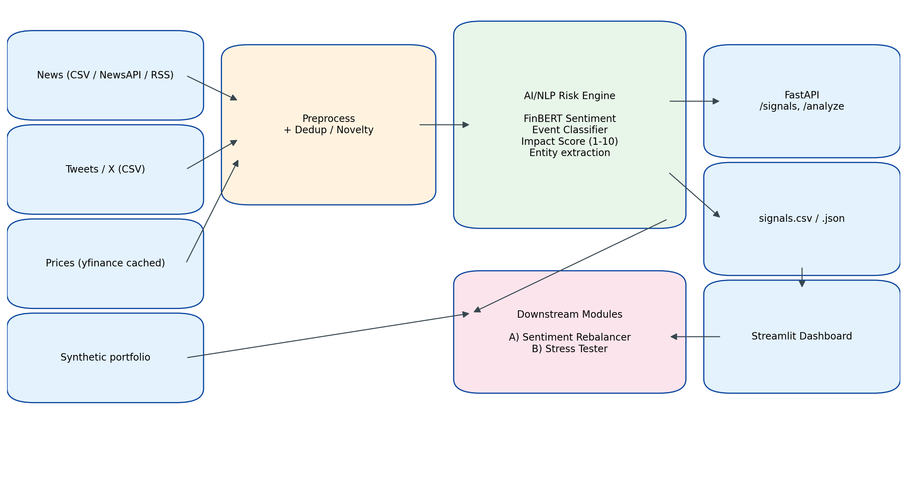

# AI/NLP Risk Engine + Tactical & Strategic Downstream Modules — S&P Global & Crisil Campus Hackathon

**Candidate Name:** Samkit Jain
**College Email ID:** 123cs0171@nitrkl.ac.in
**College / Campus:** NIT Rourkela
**Demo Video Link:** https://youtu.be/b6WMy5j7kAE?si=WM13DtM32wbHZ8LP
**Slide Deck Link (if hosted externally):** [Optional]

## 1. Project Overview / Problem Statement & Approach

Financial risk signals live in unstructured text — news wires, RSS feeds, and social posts. Turning them into machine-readable, decision-ready signals at speed is the core challenge for banks, asset managers, and market-infrastructure firms. This project implements a unified AI/NLP Risk Engine that ingests multi-source text, extracts entities, classifies events, and outputs a structured signal containing a Sentiment Score (-1 to 1), an Event Classification, and a transparent Impact Score (1-10).

The engine combines FinBERT for finance-domain sentiment with a VADER + finance-lexicon fallback (CPU/offline-safe), a keyword + optional zero-shot event classifier, and an explainable impact formula that blends event severity prior, sentiment magnitude, source credibility, recency decay, and novelty. Signals are served via a FastAPI service and persisted to CSV/JSON.

Two downstream modules demonstrate practical application: Module A tactically rebalances a 15-stock mock S&P 100 index based on decayed, impact-weighted sentiment, and backtests the result vs an equal-weight benchmark. Module B stress-tests a synthetic wholesale-banking portfolio (loans, bonds, derivatives) against event-driven shocks. A unified Streamlit dashboard surfaces live signals, weights over time, P&L waterfalls, and model-evaluation metrics.

## 2. Architecture & Tech Stack

Data flow: Sources -> ingestion adapters -> preprocess / dedup -> FinBERT + event classifier + impact scorer -> FastAPI + signals.csv/json -> Module A / Module B -> Streamlit dashboard.

Tech stack: Python 3.11, HuggingFace Transformers (FinBERT), VADER, scikit-learn, pandas/numpy, FastAPI + Uvicorn + Pydantic, Streamlit + Plotly, yfinance, pytest. Deterministic seeds; runs CPU-only on a MacBook.

## 3. Dataset Used

All data is public or synthetic, and lives in /data.

| File | Source | Notes |
|---|---|---|
| news_sample.csv | Synthetic headlines in the style of Reuters / Bloomberg / FT / WSJ / GDELT samples | 46 items |
| tweets_sample.csv | Synthetic X / Twitter posts | 46 items |
| prices.csv | yfinance if online; synthetic GBM otherwise | 15 S&P 100 tickers, ~1 year |
| portfolio_positions.csv | Synthetic wholesale-banking portfolio | 80 loans/bonds/derivatives |
| labeled_eval.csv | Hand-labeled | 30 items for event classifier eval |
| event_priors.yaml | Expert priors | Event-severity priors |

Assumptions: all headlines/portfolios are illustrative; no proprietary S&P Global, Crisil, or client data was used. yfinance is cached so the demo runs offline. Tweet data is synthetic.

## 4. Quickstart & Installation

Runtime: Python 3.11 on macOS.

    git clone <your-repo-url>
    cd nitrourkela-samkit-jain-hackathon
    python3.11 -m venv .venv
    source .venv/bin/activate
    pip install -r requirements.txt
    python -m src.ingest.bootstrap_data
    python -m src.run_pipeline
    uvicorn src.api.main:app --reload --port 8000    # http://127.0.0.1:8000/docs
    streamlit run src/dashboard/app.py               # http://localhost:8501

## 5. Key Results & Domain Impact

Outputs: ~90 structured signals with sentiment, event class and impact score. Top-impact events include SVB bankruptcy, Credit Suisse downgrade, Middle East oil spike, and OPEC+ cut — all Credit Event / Geopolitical / Macroeconomic with impact > 7.

Module A: weight tilts from sentiment produce modest but positive active return vs equal-weight; Sharpe, max drawdown, and turnover reported.

Module B: a Geopolitical shock (-15% equities, +150bp spreads, +25bp rates) triggers a material loss concentrated in Derivatives and Bonds, with a full P&L waterfall by asset class and top-10 affected positions.

Domain impact: the design mirrors how a bank's risk function would operationalize unstructured data — an explainable, auditable signal with a credibility-weighted impact score, feeding tactical rebalancing and strategic stress testing. Directly relevant to wholesale banking (credit, market, liquidity risk) and to information-services firms like S&P Global and Crisil.
